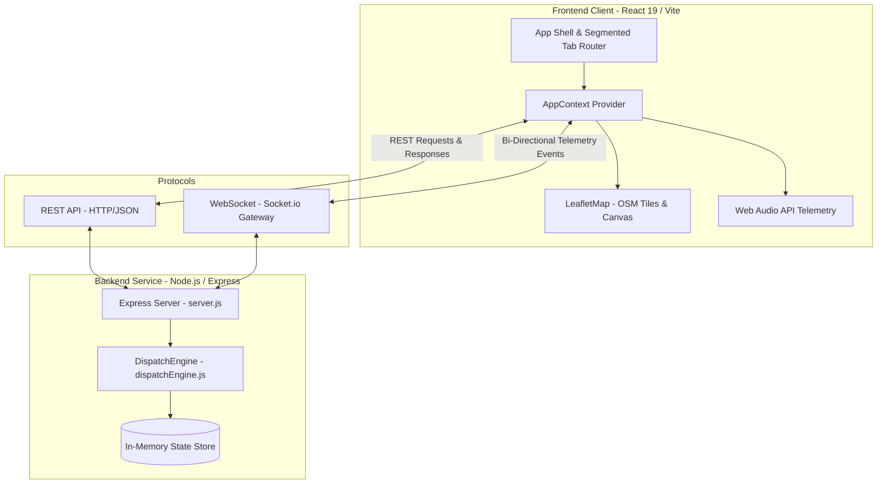
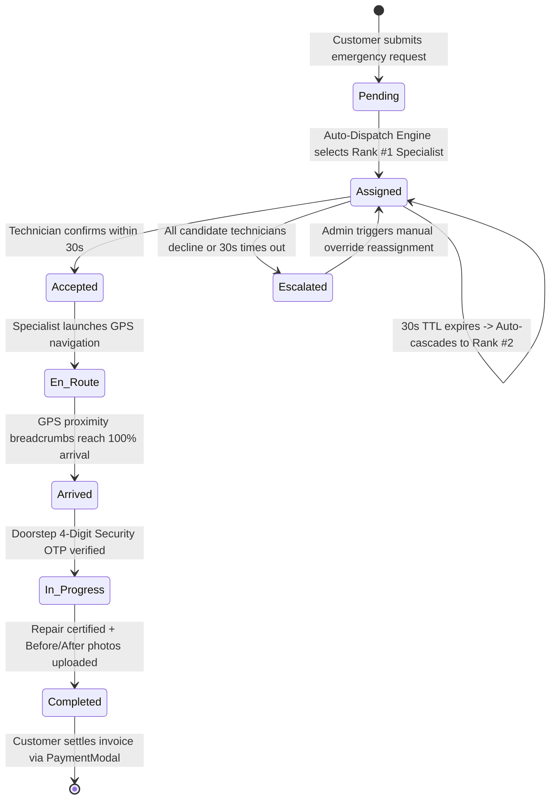

# ResQDispatch — Emergency Home Services Auto-Dispatch System
# Current Technical Architecture Specification

**Document Version**: 1.0.0 (Audited Current State)  
**System Classification**: Distributed Real-Time Geospatial Dispatch Architecture  
**Component Topology**: React SPA + Express REST API + Socket.io WebSocket Telemetry + In-Memory State Machine  
**Reference Standards**: Urban Company Service Workmanship & Unified Mentor Project Guidelines  

---

## 1. System Topology Overview

ResQDispatch connects three primary personas (**Customer**, **Technician**, and **Dispatch Administrator**) through a unified full-stack architecture.



---

## 2. Frontend Architecture

### 2.1 View Routing & Component Hierarchy
Instead of utilizing standard client-side routing libraries that trigger DOM re-mounts and tear down WebSocket connections, ResQDispatch utilizes a state-driven view router managed inside `App.jsx`:

```
App.jsx (AppProvider)
├── Navbar.jsx (Branding, Telemetry Status, Navigation Tabs, Persona Switcher)
│   ├── RoleAuthModal.jsx (Quick persona switcher between Customer, Tech, Admin)
│   └── AdminAuthModal.jsx (Credential gate for Admin Tower access)
├── IncomingOfferModal.jsx (Global technician alert modal with 30s countdown)
├── ToastNotification (Floating dynamic status badges)
└── <main> (Dynamic View Switcher via activeTab)
    ├── CustomerRequestPage.jsx ('request')
    ├── LiveTrackingPage.jsx ('tracking')
    │   ├── LeafletMap.jsx (Live tracking & proximity view)
    │   ├── DirectCallModal.jsx (Simulated dispatcher phone call)
    │   ├── SupportChatModal.jsx (Direct technician messaging)
    │   ├── PaymentModal.jsx (Checkout settlement)
    │   └── InvoiceReceiptModal.jsx (Printable 30-day guarantee invoice)
    ├── TechnicianDashboard.jsx ('tech_console')
    │   └── LeafletMap.jsx (Field navigation view)
    ├── AdminDashboard.jsx ('admin_tower')
    │   └── LeafletMap.jsx (City-wide fleet overview & distress heatmap)
    ├── ServiceHistoryPage.jsx ('history')
    └── ProfilePage.jsx ('profile')
```

### 2.2 Global State Hub (`AppContext.jsx`)
The `AppProvider` maintains reactive client-side state synchronized with server broadcasts:
- **Session State**: `currentUser` (active persona), `isAdminAuthenticated` (flag).
- **Domain State**: `technicians` (fleet roster), `requests` (incident archive), `categories` (service types).
- **Active Incident**: `activeRequestId` and `activeRequest` (computed selector).
- **Telemetry State**: `isConnected` (socket status), `incomingOffer` (active modal payload), `toastNotification`.
- **Policy Settings**: `dispatchMode` (`'direct'` vs `'broadcast'`), `isHeatmapActive` (boolean).

---

## 3. Backend Architecture & Lifecycle State Machine

### 3.1 State Machine Lifecycle
Every emergency request progresses through a strictly governed lifecycle state machine managed by `DispatchEngine.js`:



### 3.2 Geospatial Proximity Re-Clustering Logic
When an emergency request is initiated, the engine executes `reclusterTechniciansNearCustomer(customerLocation)`:
1. Calculates Haversine distance between customer coordinates and current technician positions.
2. If technicians are greater than $6\text{ km}$ away (e.g. browser GPS detects user outside Manhattan), it re-stations the 6 specialists using polar coordinate offsets:
   - Station #1 (North Precinct): $+0.0055\text{ lat}, +0.0042\text{ lng}$ ($\approx 0.7\text{ km}$)
   - Station #2 (East District): $-0.0062\text{ lat}, +0.0065\text{ lng}$ ($\approx 0.9\text{ km}$)
   - Station #3 (West Quarter): $+0.0084\text{ lat}, -0.0051\text{ lng}$ ($\approx 1.1\text{ km}$)
   - Station #4 (South Sector): $-0.0091\text{ lat}, -0.0078\text{ lng}$ ($\approx 1.4\text{ km}$)
   - Station #5 (Central Hub): $+0.0118\text{ lat}, +0.0074\text{ lng}$ ($\approx 1.7\text{ km}$)
   - Station #6 (Rapid Depot): $-0.0135\text{ lat}, +0.0049\text{ lng}$ ($\approx 2.1\text{ km}$)
3. Broadcasts `technicians_updated` to all connected clients, guaranteeing instantaneous map re-centering.

---

## 4. Socket.io Event Dictionary

| Event Name | Direction | Payload Structure | Purpose |
| :--- | :---: | :--- | :--- |
| `initial_state` | S $\rightarrow$ C | `{ technicians, requests, categories }` | Hydrates client state upon connection. |
| `request_created` | S $\rightarrow$ C | `{ id, category, priority, location, ... }` | Alerts clients of a new emergency incident. |
| `dispatch_assigned` | S $\rightarrow$ C | `{ requestId, technician, distanceKm, etaMinutes, timeoutSeconds }` | Triggers technician alert modal and audio siren. |
| `dispatch_countdown` | S $\rightarrow$ C | `{ requestId, technicianId, remainingSeconds }` | 1-second interval heartbeat for 30s TTL timer. |
| `dispatch_timeout` | S $\rightarrow$ C | `{ requestId, technicianId, techName, nextAttempt }` | Informs clients of candidate expiration & cascading. |
| `location_updated` | S $\rightarrow$ C | `{ requestId, technicianId, coordinates, remainingDistanceKm, etaMinutes, progress }` | Live GPS breadcrumbs during vehicle transit. |
| `request_updated` | S $\rightarrow$ C | `Request Object` | Full incident object update on status transitions. |
| `technicians_updated`| S $\rightarrow$ C | `Array<Technician>` | Roster update on duty status, location, or balance changes. |
| `request_escalated` | S $\rightarrow$ C | `{ requestId, reason, request }` | Alerts admin when all specialists decline or time out. |
| `requests_reset` | S $\rightarrow$ C | `Array<Request>` | State reset notification to restore clean baseline. |

---

## 5. Complete REST API Route Catalog

### 5.1 Authentication & Workforce Roster
- `GET /api/auth/users`: Returns registered seed users and technicians.
- `POST /api/auth/login`: Authenticates user; validates password `admin123` for admin roles.
- `GET /api/categories`: Returns service categories (Plumbing, Electrical, HVAC, Gas, Appliances, Carpentry).
- `GET /api/technicians`: Returns all 6 fleet technicians.
- `GET /api/technicians/:id`: Returns individual technician profile and wallet balance.
- `PUT /api/technicians/:id/toggle-online`: Toggles technician duty availability (`online`/`offline`).
- `PUT /api/technicians/:id/location`: Updates manual GPS coordinates for a specialist.
- `POST /api/technicians/recluster`: Re-stations fleet specialists in customer vicinity.
- `POST /api/technicians/:id/payout`: Transfers accumulated wallet balance to registered bank account.

### 5.2 Emergency Incident Lifecycle
- `GET /api/requests`: Queries incident archives with optional filters (`customerId`, `technicianId`, `status`).
- `GET /api/requests/:id`: Retrieves specific incident details.
- `POST /api/requests`: Creates new emergency incident and triggers `autoDispatch()`.
- `POST /api/requests/:id/accept`: Specialist accepts assigned job offer within 30s.
- `POST /api/requests/:id/reject`: Specialist declines job offer; triggers immediate cascade to Rank #2.
- `POST /api/requests/:id/navigate`: Specialist starts GPS driving transit toward incident site.
- `POST /api/requests/:id/arrived`: Specialist arrives on site.
- `POST /api/requests/:id/verify-otp`: Verifies 4-digit security code provided by customer; authorizes service start.
- `POST /api/requests/:id/work`: Initiates active repair work.
- `POST /api/requests/:id/photos`: Uploads Before (Triage) and After (Certified) repair photo proof.
- `POST /api/requests/:id/complete`: Completes incident, records parts used, notes, and credits technician wallet (85%).
- `POST /api/requests/:id/pay`: Settles invoice with payment method (Apple Pay, Google Pay, Card).
- `POST /api/requests/:id/rate`: Submits verified customer star rating (1–5) and review feedback tags.
- `POST /api/requests/:id/cancel`: Cancels active emergency request and frees assigned technician.
- `POST /api/requests/:id/advance`: Manual demo fast-forward action advancing incident to next milestone.

### 5.3 Administrative & Audit Endpoints
- `GET /api/admin/kpis`: Returns computed fleet metrics (Avg Dispatch Time, Active Jobs, Utilization %, Avg ETA, Accuracy).
- `GET /api/admin/reports/csv`: Streams RFC 4180-compliant CSV spreadsheet containing full incident audit trail.
- `POST /api/admin/override`: Force-assigns any incident (including escalated) to a selected technician.
- `POST /api/admin/simulate-emergency`: Injects a simulated emergency in Manhattan with random category and coordinates.
- `POST /api/admin/reset`: Resets state store to pristine seed data (0 requests, original technician balances).
