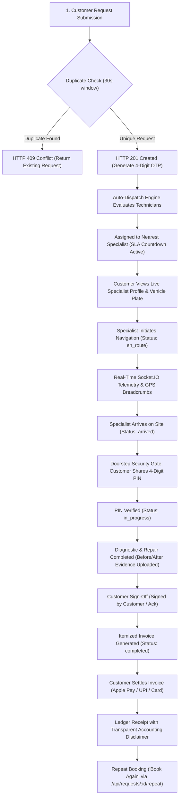
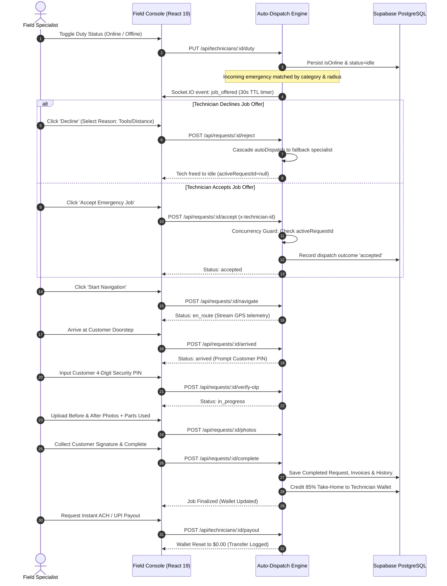

# RESQDISPATCH — Phase 7: Complete End-to-End Workflow & Operator Guide

**Document**: End-to-End Workflow Specification  
**System**: ResQDispatch Emergency Home Services Auto-Dispatch System  
**Version**: 7.0 (Production Verified)  
**Date**: November 23, 2026  

---

## 1. Customer Workflow Lifecycle

### 1.1 Customer Registration & Address Management
- **Registration & Auth**: Users register via `POST /api/auth/register` and authenticate via `POST /api/auth/login`. Sessions and roles (`customer`, `technician`, `admin`) are stored in secure local state.
- **Saved Address Presets**: Customers manage saved home, office, and parent addresses via `GET /api/customers/:id/addresses` and `POST /api/customers/:id/addresses`. In [CustomerRequestPage.jsx](file:///c:/Users/dell/OneDrive/Desktop/CodeGuard%20AI%20(2)/emergency-dispatch-system/client/src/pages/CustomerRequestPage.jsx), one-click address pills pre-fill coordinates and verified street addresses.

### 1.2 Request Submission & Duplicate Prevention
- **Category Selection**: Choose from Plumbing, Electrical, HVAC & Climate, Gas & Hazmat, Major Appliances, or Lockout & Security.
- **Duplicate Interception**: If an identical category and description are submitted by the same customer within 30 seconds of an active request, the API rejects it with **HTTP 409 Conflict** and provides a one-click redirect to the active incident tracking screen.

### 1.3 Live Tracking & Telemetry
- **Assigned Specialist Dossier**: Once assigned, the customer receives the specialist's photo, name, category certification, star rating, verified review count, vehicle model, and registration plate.
- **Socket.IO Breadcrumbs**: Live location coordinates are broadcast over the `request_{id}` room, displaying smooth marker animations on Leaflet maps with remaining ETA and distance in kilometers.

### 1.4 Doorstep OTP Verification & Payment
- **4-Digit Physical PIN**: On the customer tracking screen, a secure 4-digit PIN (e.g., `5032` or standard demo PIN `7842`) is displayed in an amber security badge.
- **Verification Gate**: The technician cannot begin billed work until the customer provides this PIN.
- **Invoice Settlement**: After job completion, an itemized invoice is displayed. Customers settle via Apple Pay, UPI, or Card. The response generates an internal double-entry ledger receipt with a clear disclaimer.
- **Repeat Booking**: In [ServiceHistoryPage.jsx](file:///c:/Users/dell/OneDrive/Desktop/CodeGuard%20AI%20(2)/emergency-dispatch-system/client/src/pages/ServiceHistoryPage.jsx), customers can click "Book Again" to re-instantiate identical service parameters in 1 click.

---

## 2. Technician Field Operations Workflow

### 2.1 Concurrency & Reassignment Safeguards
- A technician cannot accept two active emergency jobs at the same time. If a technician already holds an ongoing assignment, acceptance attempts on conflicting requests return HTTP 400.
- When declining a job, the technician is immediately freed to `idle` status, while the dispatch engine re-ranks remaining eligible specialists.

### 2.2 Proof of Work & Audit Integrity
- Mandatory evidence upload validates file size (<300KB) and strictly disallows executable scripts or SVG files to prevent stored cross-site scripting (XSS).
- Customer digital signature or verbal acknowledgement is captured alongside diagnostic notes and replacement parts used.

### 2.3 Financial Wallet & 85/15 Payout Split
- Each completed job automatically calculates the technician's 85% net earnings (with 15% retained as platform revenue).
- Technicians can trigger an instant payout (`POST /api/technicians/:id/payout`) which resets the wallet balance and records an audit log receipt.

---

## 3. Admin Command Tower & Fleet Governance

```mermaid
flowchart LR
    subgraph Monitoring ["Real-Time Command Tower"]
        KPIs["Real-Time Fleet KPIs (Available, Busy, Offline)"]
        LiveFeed["Live Incident Stream (Priority & Status Badges)"]
        Heatmap["Leaflet Geospatial Distress Clusters"]
    end

    subgraph Actions ["Supervisory Controls"]
        Reassign["Manual Override / Reassign (Concurrency Guarded)"]
        Cancel["Emergency Cancel (Mandatory Reason Required)"]
        Escalate["SLA Escalation (Supervisor Alert)"]
        Suspend["Workforce Duty & Suspension Controls"]
    end

    subgraph Intelligence ["Phase 5 AI Workspace"]
        Forecast["7-Day Demand Predictor (Holt-Winters)"]
        ETAEngine["Multi-Variate Rush Hour ETA Predictor"]
        Anomaly["Z-Score / IQR Anomaly Detector"]
        Rules["Deduplicated Automation Rule Engine"]
    end

    Monitoring --> Actions
    Actions --> Intelligence
```

### 3.1 Supervisory Overrides & Safety Guards
- **Manual Reassignment**: Administrators can reassign an active incident to any specialist. The concurrency guard prevents assigning busy technicians who already have ongoing active jobs.
- **Mandatory Cancellation Audit**: Cancelling an emergency requires a reason, recorded immediately in the immutable PostgreSQL and in-memory audit logs.
- **Finalized Job Lockout**: Completed or cancelled requests cannot be re-dispatched, re-assigned, or altered.

### 3.2 Dual-Layer Audit Trail
- All administrative mutations (`CANCEL_REQUEST`, `REASSIGN_REQUEST`, `ESCALATE_REQUEST`, `UPDATE_TECHNICIAN_STATUS`, `UPDATE_CUSTOMER_STATUS`) are written to both PostgreSQL (`prisma.auditLog`) and the server's in-memory journal, ensuring zero data loss even during network hiccups.

---

## 4. Edge Cases & Resilience Mechanisms

| Scenario / Edge Case | Failure Mode Without Hardening | ResQDispatch Phase 7 Behavior |
| :--- | :--- | :--- |
| **Double Clicks on Booking** | Creates duplicate emergency incidents, dispatching two specialists to the same home. | Intercepted by 30s sliding window check. Returns **HTTP 409 Conflict** with existing request ID. |
| **Technician Double Acceptance** | Two emergency requests accepted by one specialist, causing severe SLA delays. | Concurrency guard validates `activeRequestId`. Second request returns HTTP 400 rejection. |
| **Rogue Customer Cancellation** | Malicious user cancels another customer's emergency booking. | Multi-tenant ownership guard validates `x-customer-id`. Returns **HTTP 403 Forbidden**. |
| **Technician Invoice Settlement** | Specialist settles customer invoice without payment. | Role separation guard blocks `x-user-role: technician` on `/pay`. Returns **HTTP 403 Forbidden**. |
| **Double Invoice Payment** | Customer double-clicks or pays twice for same repair. | Payment guard detects `invoice.isPaid === true`. Returns **HTTP 400 Bad Request**. |
| **Overseas DB Pooler Latency** | Remote PostgreSQL write hangs and freezes the Node.js API process. | `withDbTimeout` enforces 4000ms ceiling. Real-time auto-dispatch continues without latency. |
| **Socket Connection Drop** | Client reconnects with stale in-memory state. | Client sends `sync_state` over WebSocket. Server broadcasts complete current state snapshot. |
| **Rapid Succession DB Updates** | Out-of-order Prisma writes overwrite `completed` with `arrived`. | Server explicitly awaits `updateRequest` on `/complete`, guaranteeing terminal state in PostgreSQL. |
