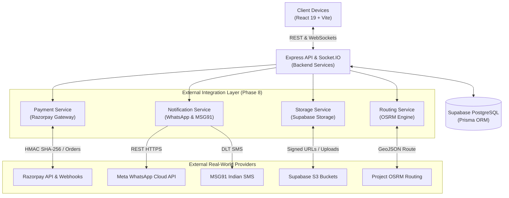
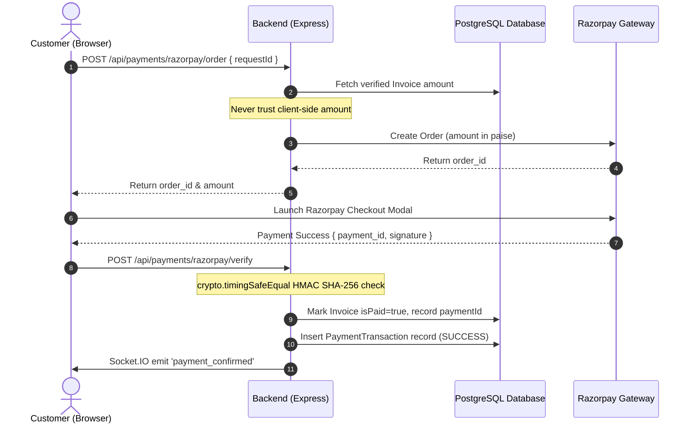
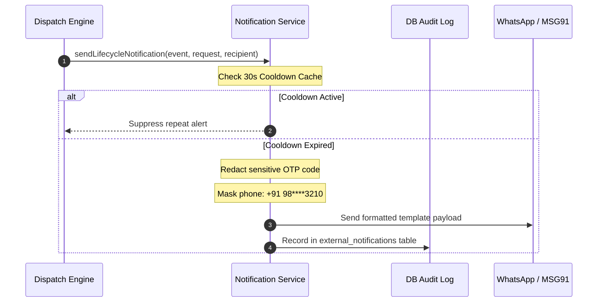
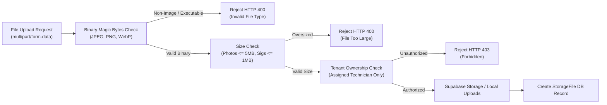
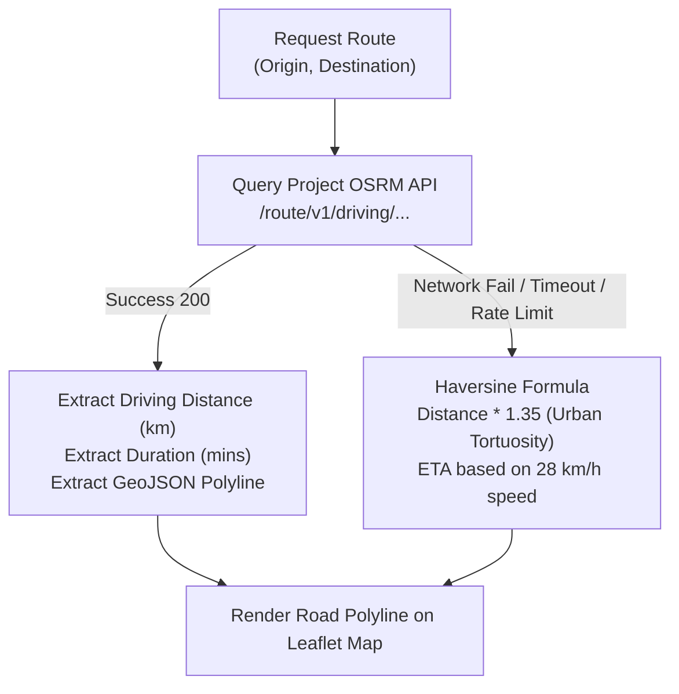
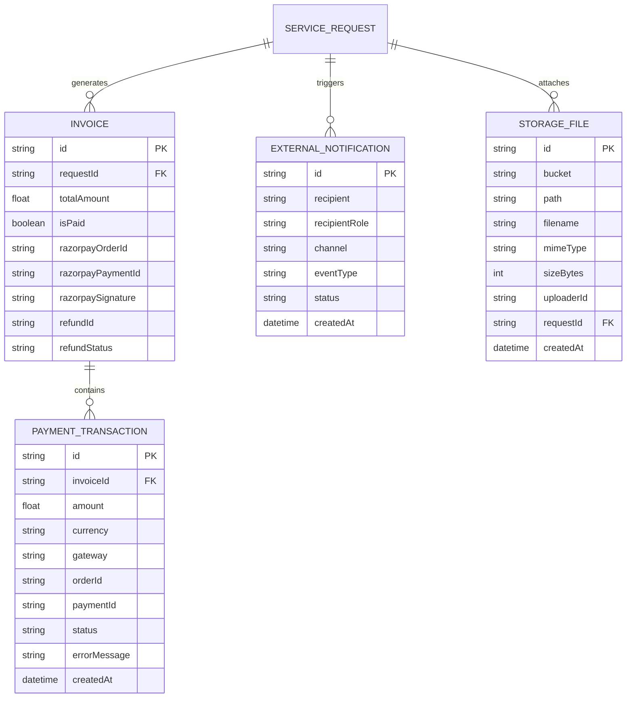

# RESQDISPATCH — Phase 8: Integration Architecture & Data Flow

**System**: ResQDispatch Emergency Home Services Auto-Dispatch System  
**Document**: Phase 8 Real-World Integration Architecture & Security Boundaries  
**Date**: November 24, 2026  
**Status**: Active Production Standard

---

## 1. System Architecture Overview

Phase 8 introduces a dedicated **External Service Integration Layer** situated between the core ResQDispatch business logic engines and third-party external APIs:

---

## 2. Integration Data Flows

### 2.1 Razorpay Payment Flow & Double-Entry Financial Segregation

#### Financial Integrity Safeguards:
1. **Authoritative Amounts**: The payment gateway order is created solely from the backend invoice amount.
2. **Double-Payment Guard**: Invoices with `isPaid: true` automatically reject new order creation or verification attempts.
3. **Ledger Segregation**: Internal technician commissions and platform splits are stored in the double-entry accounting ledger. Bank payouts remain segregated until explicitly settled by administrative disbursement.

---

### 2.2 Dispatch Alert Data Flow & Security Redaction

#### Security Redaction Guard:
- When a specialist is notified that an emergency request has arrived (`TECHNICIAN_ARRIVED`), the notification instructs the specialist to request the verbal arrival PIN from the customer.
- Under NO circumstance does the technician notification include the customer's PIN code.

---

### 2.3 Cloud Storage Architecture & Magic Bytes Gate

---

### 2.4 Road Routing & Calibrated Haversine Fallback

---

## 3. Database Schema Entity Relationship Diagram

