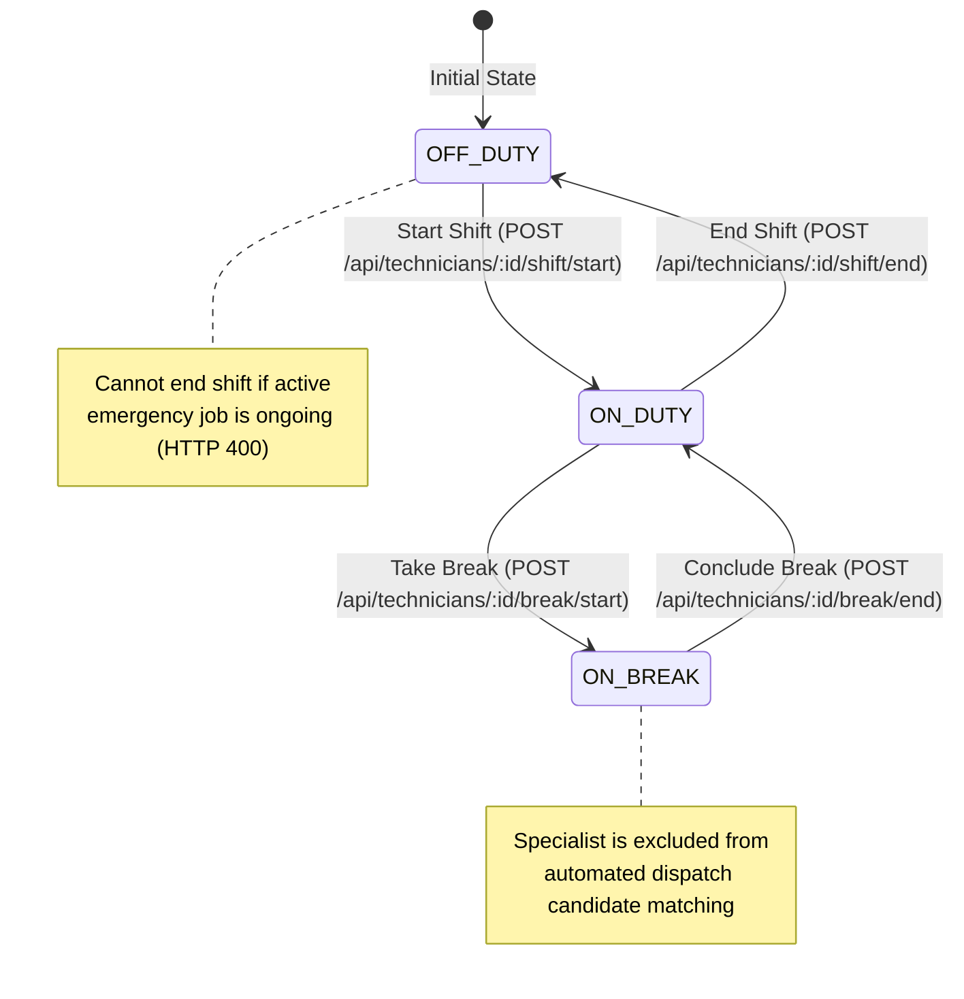
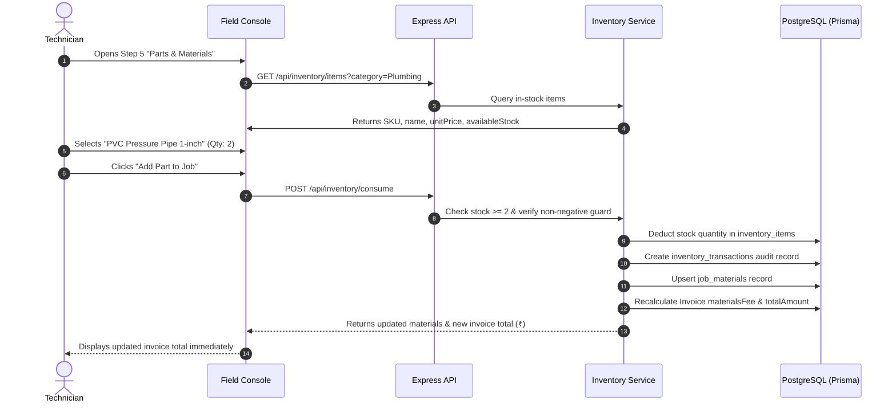
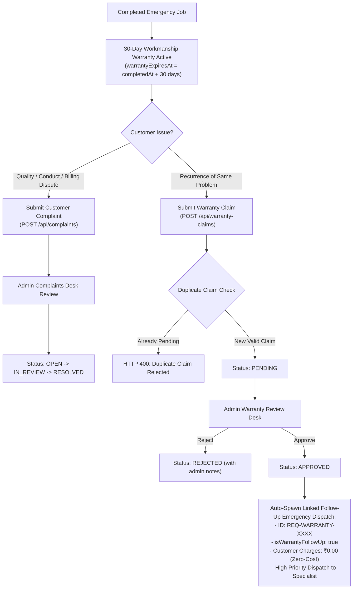

# RESQDISPATCH — Phase 9: Field Operations, Workforce & Customer Support Workflow

**Document**: Field Operations, Workforce Management and Support Guide  
**System**: ResQDispatch Emergency Home Services Auto-Dispatch System  
**Date**: November 24, 2026  
**Status**: Standard Operating Procedure (SOP) & Technical Reference

---

## 1. Technician Shift & Availability Lifecycle

### Shift Rules:
1. **Starting Shift**:
   - A technician clicks "Start Shift" on the Field Console.
   - The backend creates a record in `technician_shifts`, sets `technician.shiftStatus = 'ON_DUTY'`, and updates `technician.isOnline = true`.
   - The technician is now included in auto-dispatch scoring.
2. **Operational Break**:
   - Technicians can take a temporary break for rest, meal, or vehicle fueling.
   - Sets `shiftStatus = 'ON_BREAK'` and records `breakStartedAt`.
   - The auto-dispatch engine (`dispatchEngine.findCandidates`) filters out any specialist whose status is `ON_BREAK` or `isOnBreak === true`.
3. **Ending Shift**:
   - Technicians click "End Shift" when their daily roster concludes.
   - **Active-Job Guard**: If the technician is assigned to an emergency that is not `completed` or `cancelled`, the server rejects the request:
     `HTTP 400: Cannot end shift: Specialist has an active emergency assignment (REQ-XXXX). Complete or reassign the incident first.`
   - Once cleared, the shift ends, calculates duration in minutes, and updates `isOnline = false`.

---

## 2. Emergency Materials & Spare-Part Inventory Workflow

### Warehouse Stock Controls:
- **Low Stock Threshold**: Each item has a configured `minThreshold` (e.g., 5 or 10 units). If `stockQuantity <= minThreshold`, a low-stock alert is raised in the Admin Dashboard.
- **Transactional Stock Adjustment**: Admins can restock inventory via `POST /api/inventory/adjust`. Every adjustment records the reason (`Central Warehouse Restock`, `Damaged Return`) and delta in `inventory_transactions`.
- **Financial Integration**: Material consumption updates the invoice `materialsFee` and increases `totalAmount`. Platform take-rate and technician earnings are preserved accurately.

---

## 3. Customer Complaints & 30-Day Workmanship Warranty

### Warranty Rules:
1. **Eligibility**: Standard workmanship warranty is valid for 30 calendar days from the moment the original job was marked `completed`.
2. **Duplicate Prevention**: A customer cannot file multiple concurrent pending claims on the same emergency request.
3. **Zero-Cost Resolution**: When an admin approves a warranty claim, the system automatically spawns a zero-cost linked service request (`REQ-WARRANTY-XXXX`) that is immediately placed into the auto-dispatch candidate matching engine.
