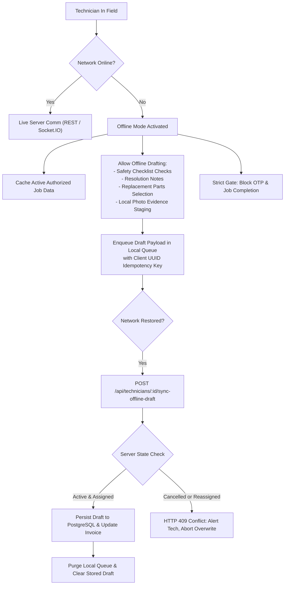

# RESQDISPATCH — Phase 9: Offline-Safe Synchronization Architecture

**Document**: Field Operations Offline Synchronization Specification  
**System**: ResQDispatch Emergency Home Services Auto-Dispatch System  
**Date**: November 24, 2026  
**Status**: Architecture Standard & Implementation Reference

---

## 1. Architectural Philosophy

Emergency field service operations occur in high-stress, low-connectivity physical environments (basements, remote properties, dense urban elevator shafts, and post-storm utility outages).

The ResQDispatch offline design balances two non-negotiable imperatives:
1. **Technician Productivity**: The field specialist must be capable of recording safety checklists, noting diagnosis details, selecting installed replacement parts, and staging photo evidence without being blocked by temporary cellular dropouts.
2. **Security & Financial Integrity**: State transitions involving customer identity validation (doorstep arrival OTP), legal authorization, and financial settlements (`accept`, `arrive`, `verify-otp`, `complete`, `pay`) **CANNOT** be fabricated or transitioned offline. These operations require server-authoritative verification.



---

## 2. Local Storage Partitioning & Security

To prevent cross-tenant data leaks and device theft exposure, the client implements strict data lifecycle rules:

| Storage Key | Lifecycle | Scope & Security |
| :--- | :--- | :--- |
| `resq_active_job_<techId>` | Overwritten on assignment; cleared on job completion or logout | Caches authorized active incident only (customer address, customer name, issue description). Plaintext arrival OTP is **NEVER** stored. |
| `resq_offline_queue_<techId>` | Queued mutations; drained upon successful server synchronization | Contains pending checklists, text notes, selected material IDs, and base64 evidence thumbnails. |
| `resq_cached_inventory` | Refreshed on app startup / daily | Read-only catalog of spare parts (SKUs, names, unit prices) for local selection. |

---

## 3. Idempotency & Conflict Resolution Protocol

### 3.1 Idempotency Key Header
Every synchronization attempt delivers a unique UUID v4 idempotency key:
```http
POST /api/technicians/t_plumb_1/sync-offline-draft HTTP/1.1
Content-Type: application/json
Idempotency-Key: c9a3e210-67c1-4b18-912a-3518349281a1

{
  "requestId": "REQ-7937",
  "notes": "Replaced cracked 1-inch pressure pipe under kitchen sink.",
  "safetyChecks": {
    "valveShut": true,
    "leakChecked": true,
    "areaSecured": true
  },
  "materialsUsed": [
    { "itemId": "inv_plumb_pvc_1in", "quantity": 2 }
  ],
  "photos": [
    { "type": "before", "url": "data:image/jpeg;base64,..." }
  ]
}
```

### 3.2 Server Verification Lifecycle
1. **Assignment Verification**: Verify that `technicianId` matches the currently assigned specialist on `ServiceRequest`. If unassigned or assigned to someone else, return `403 Forbidden` (`UNAUTHORIZED_TECHNICIAN`).
2. **Server State Precedence Guard**: Verify that the server status is an active working state (`assigned`, `accepted`, `en_route`, `arrived`, `in_progress`). If the incident was cancelled or marked complete by admin while the technician was disconnected, return `409 Conflict` (`SERVER_STATE_CONFLICT`).
3. **Idempotent Storage**: Cache the processed draft result. If the same `idempotencyKey` arrives again (e.g. from network retry), immediately return the previous successful response without duplicate database writes or inventory stock double deductions.
4. **Inventory Reservation**: If `materialsUsed` is specified, atomically verify stock availability and record deductions via `InventoryTransaction`.

---

## 4. Reconnection & Auto-Retry Loop

The client registers browser `window.addEventListener('online', ...)` and `window.addEventListener('offline', ...)` event handlers:
- **On Network Drop**: The UI transitions to `Offline Mode (Drafting Safe)` with an amber banner.
- **On Network Return**: The sync worker immediately kicks off, draining `resq_offline_queue_<techId>`.
- **Exponential Backoff**: If the backend is unreachable or returns `503 Service Unavailable`, retries execute at intervals of 2s, 4s, 8s, up to a maximum of 30s.
- **Conflict Handling**: If `409 Conflict` is returned, a persistent warning modal informs the technician that the job was modified or cancelled by dispatch, allowing manual review rather than silent data corruption.
