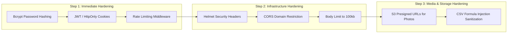

# ResQDispatch — Emergency Home Services Auto-Dispatch System
# Master Security & Vulnerability Audit Report

**Auditor Role**: Senior Full-Stack Security Architect & Technical Auditor  
**Audit Standard**: OWASP Top 10 (2021) & Enterprise Web Application Security Guidelines  
**Scope**: Server Middleware, Authentication, Endpoints, Network Configuration, Data Storage, and Client State  
**Classification**: **High-Severity Security Findings (Typical of Prototype/Demo Architecture)**  

---

## 1. Executive Security Summary

While the **ResQDispatch** system exhibits outstanding operational functionality, geospatial routing, and interactive UX design, the current codebase operates on an **in-memory demo security model**. 

For production deployment, the platform requires cryptographic authentication, session signing, strict CORS boundaries, rate limiting, and persistent encrypted storage.

---

## 2. Threat Modeling & Vulnerability Findings

### 2.1 Authentication & Credential Storage (Critical Severity)
- **Vulnerability**: Plaintext Passwords & Hardcoded Admin Credentials.
  - *Location*: `server/mockData.js` and `server/server.js` (lines 74–79).
  - *Detail*: Passwords (`admin123`, `cust123`, `tech123`) are stored in plaintext and evaluated via direct string comparison:
    ```javascript
    if (role === 'admin' || (email && email.toLowerCase().includes('admin'))) {
      if (password !== 'admin123') {
        return res.status(401).json({ success: false, error: 'Invalid administrator credentials.' });
      }
    }
    ```
  - *Risk*: Complete compromise of administrative dispatch operations if source code or network payloads are inspected.
  - *Remediation*: Hash all credentials using **Argon2id** or **bcrypt** with a minimum salt factor of 12.

### 2.2 Lack of Session Tokens / Cryptographic Claims (High Severity)
- **Vulnerability**: Client-Declared Role Identity.
  - *Location*: `client/src/context/AppContext.jsx` and `server/server.js`.
  - *Detail*: The backend does not issue signed JSON Web Tokens (JWT) or HTTP-only session cookies upon login. Instead, client requests pass `customerId`, `technicianId`, and `role` directly in HTTP request bodies.
  - *Risk*: Insecure Direct Object Reference (IDOR) and Identity Spoofing. Any malicious user using curl or Postman can claim to be `admin` or any technician ID to accept/cancel requests or trigger bank payouts.
  - *Remediation*: Implement JWT authentication with short-lived access tokens (15m) and secure HTTP-only refresh tokens. Enforce server-side middleware `verifyAuth` and `requireRole(['admin', 'technician'])`.

### 2.3 Permissive Cross-Origin Resource Sharing (CORS) (Medium Severity)
- **Vulnerability**: Universal Origin Acceptance.
  - *Location*: `server/server.js` (line 18, line 25).
  - *Detail*: CORS is configured as `app.use(cors({ origin: '*' }))` and Socket.io is configured with `cors: { origin: '*' }`.
  - *Risk*: Cross-Site Scripting (XSS) and unauthorized third-party domains can establish WebSocket connections and eavesdrop on city-wide emergency dispatch feeds.
  - *Remediation*: Restrict CORS origins strictly to authorized production domains defined via `process.env.ALLOWED_ORIGINS`.

### 2.4 Denial of Service (DoS) via High Body Parser Limit (High Severity)
- **Vulnerability**: 50MB Uncompressed JSON Payload Allowance.
  - *Location*: `server/server.js` (lines 19–20).
  - *Detail*: Express body parser is configured with `limit: '50mb'` to facilitate base64 image uploads:
    ```javascript
    app.use(express.json({ limit: '50mb' }));
    app.use(express.urlencoded({ extended: true, limit: '50mb' }));
    ```
  - *Risk*: A malicious client could send multiple concurrent 45MB requests, rapidly exhausting Node.js heap memory (default ~1.4GB) and crashing the entire server process.
  - *Remediation*: Reduce body parser limit to `100kb`. Offload image attachments to direct multipart file uploads or S3/Cloudflare R2 presigned URLs with strict 5MB file caps.

### 2.5 Absence of Rate Limiting & Brute-Force Protection (Medium Severity)
- **Vulnerability**: Unrestricted Endpoint Hammering.
  - *Location*: All REST endpoints in `server/server.js`.
  - *Detail*: No rate-limiting middleware (`express-rate-limit`) is installed.
  - *Risk*: An attacker can spam `/api/admin/simulate-emergency`, flood the in-memory array with thousands of tickets, or brute-force the 4-digit doorstep security OTP (`verifyOTP`) within minutes.
  - *Remediation*: Implement `express-rate-limit` (e.g., 5 OTP attempts per 10 minutes per incident; 100 requests per minute for standard API endpoints).

### 2.6 CSV Formula Injection Vulnerability (Medium Severity)
- **Vulnerability**: Unsanitized Cell Values in CSV Export.
  - *Location*: `server/server.js` (`/api/admin/reports/csv`, lines 344–360).
  - *Detail*: Customer names and incident descriptions are wrapped in quotes but not sanitized for spreadsheet formula execution characters (`=`, `+`, `-`, `@`).
  - *Risk*: If a customer enters an issue description such as `=cmd|' /C calc'!A0`, an administrator opening the exported CSV in Microsoft Excel could be exposed to remote formula execution.
  - *Remediation*: Prepend a single quote `'` to any cell value that starts with `=`, `+`, `-`, or `@`.

---

## 3. OWASP Top 10 (2021) Compliance Matrix

| OWASP Vulnerability Category | Status in ResQDispatch | Risk Level | Primary Cause |
| :--- | :---: | :---: | :--- |
| **A01: Broken Access Control** | **VULNERABLE** | **HIGH** | Role claims passed in payload; no server-side token enforcement. |
| **A02: Cryptographic Failures** | **VULNERABLE** | **CRITICAL** | Plaintext password storage; lack of TLS/SSL in local development. |
| **A03: Injection** | **LOW RISK** | **LOW** | No SQL database currently present; CSV export requires formula prefixing. |
| **A04: Insecure Design** | **MITIGATED** | **LOW** | 4-digit doorstep OTP and OSHA checklist provide strong business logic controls. |
| **A05: Security Misconfiguration** | **VULNERABLE** | **MEDIUM** | `cors: *`, missing `helmet` headers, 50MB body limit. |
| **A06: Vulnerable & Outdated Components**| **SECURE** | **LOW** | React 19, Vite 8, Express 4.21, Socket.io 4.8 are modern versions. |
| **A07: Identification & Auth Failures** | **VULNERABLE** | **CRITICAL** | No session expiration, no brute-force OTP lockouts, hardcoded credentials. |
| **A08: Software & Data Integrity Failures**| **SECURE** | **LOW** | Clean npm lockfiles, zero untrusted CDN script injections. |
| **A09: Security Logging & Monitoring** | **PARTIAL** | **MEDIUM** | Console logging present; lacks persistent structured audit logging (Winston/Pino). |
| **A10: Server-Side Request Forgery (SSRF)**| **SECURE** | **LOW** | Server does not fetch arbitrary external URLs based on user input. |

---

## 4. Priority Security Hardening Checklist



1. **Install Security Dependencies**:
   `npm install helmet express-rate-limit bcryptjs jsonwebtoken cookie-parser zod`
2. **Implement Rate Limiter**:
   Throttle OTP verification attempts to 5 trials per IP/request.
3. **Restrict CORS**:
   Replace `*` with explicit allowed origin whitelist.
4. **Implement Helmet**:
   Inject secure HTTP headers (Content-Security-Policy, HSTS, X-Frame-Options).
5. **Decouple Media**:
   Replace base64 body parsing with direct cloud storage uploads.
